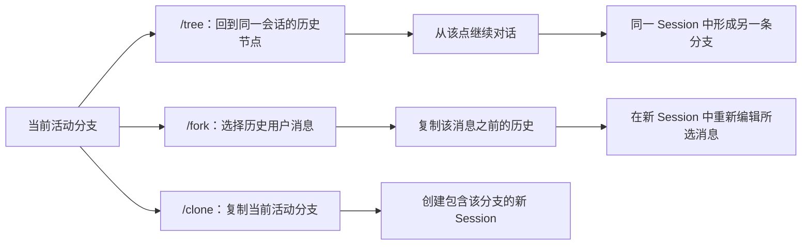

## 第 4 章：日常使用

把 Pi 当作日常工具用，记住这些就够了：

### 4.1 界面结构

交互模式下界面分四块，从上到下：

```
┌──────────────────────────────────────────┐
│ 顶部：启动信息                           │
│ 快捷键 · 已加载的上下文/模板/Skill/扩展  │
├──────────────────────────────────────────┤
│ 中间：消息区                             │
│ 你和模型的来回 · 工具调用 · 返回结果     │
├──────────────────────────────────────────┤
│ 底部：输入框（边框颜色=思考强度）        │
├──────────────────────────────────────────┤
│ 状态栏：目录·会话·token/花费/占用·模型   │
└──────────────────────────────────────────┘
```

两个地方值得盯：输入框的**边框颜色**代表当前的“思考强度”（越高模型想得越久、越贵）；状态栏的**上下文占用**就是第 1 章说的那个会一直涨的 context，涨到接近上限你就该考虑用下面要讲的 `/compact` 了。

### 4.2 编辑器操作

| 操作 | 效果 |
|---|---|
| `@` | 模糊搜索并引用项目文件 |
| Tab | 路径补全 |
| Shift+Enter | 换行（不发送） |
| Ctrl+X | 复制上一条回复 |
| Ctrl+V（Windows/WSL 默认 Alt+V）/ 拖拽 | 粘贴/拖入图片 |
| `!command` | 执行 shell 命令，结果发给模型 |
| `!!command` | 执行 shell 命令，结果**不**发给模型 |

### 4.3 常用 Slash 命令

按用途分组：

```
# 认证 / 模型 / 设置
/login  /logout          登录登出
/model                   切换模型
/settings                思考强度、主题、传输方式等

# 会话管理（都是围绕“一段对话历史”做文章）
/resume                  接着上次停的地方继续
/new                     开一段新对话
/fork                    选择历史用户消息，将此前历史复制到新会话
/clone                   将当前活动分支复制到新会话

# 上下文管理
/compact [prompt]        压缩上下文——状态栏的“占用”快满时用这个
/tree                    跳到历史任意一点接着往下聊

# 项目管理
/trust                   信任当前项目（扩展只在信任后加载）
/reload                  改完扩展/上下文文件后热重载，不用重启
```

几个最容易用错的：`/compact` 不是“清空”，而是“让模型把前面的对话总结压缩成一段”，腾出 context 继续往下聊；`/tree` 像版本管理里的“回到任意 commit”，适合“模型刚才走歪了，我想从前面某一步重来”；`/fork` 和 `/clone` 都能复制会话，区别是 `/fork` 选择历史用户消息，保留所选点之前的历史并在新会话中重新编辑该消息；`/clone` 复制当前活动分支。两者都不会把新会话放进原会话的 `/tree`；要在同一会话中分叉，应使用 `/tree` 返回历史点后继续。



> `/tree` 是在原会话树中导航；`/fork` 与 `/clone` 会创建新会话，新会话不会出现在原会话的 `/tree` 中。

### 4.4 非交互模式（写脚本/CI 时用）

```bash
pi -p "总结这份 PR 的改动"                     # 单次问答，输出后退出
pi -p "描述这张图" @screenshot.png             # 带文件/图片
pi --mode json -p "..."                        # JSON 事件流，方便程序解析
pi --no-extensions --tools read,grep,find,ls -p "只读审查代码"  # 限制工具，只读模式很适合做审查类任务
```

`--tools`/`-t` 限制模型可调用的工具；配合 `--no-extensions` 关闭自动扩展加载，避免扩展初始化或事件处理器额外执行代码。**Reviewer 角色也采用这两层配置**；它们限制本次 Agent 的工具接口，不构成操作系统沙箱。

### 4.5 动手练习

以下 3 个练习帮你巩固本章内容。每个约 3-5 分钟。

#### 练习 1：会话管理——在同一棵树中走两条路径

```
pi
帮我写一个快速排序函数                    # 让 Pi 写代码
把变量名改成中文                            # 路径 A
/tree                                       # 返回写完快速排序后的历史点
改用迭代而不是递归                          # 路径 B
/tree                                       # 跳回某个历史点对比两条路径
```

你会在 `/tree` 视图里看到分叉，像 Git 的分支图。这是 Pi 独有的会话树能力。

#### 练习 2：只读审查模式

```bash
pi --no-extensions --tools read,grep,find,ls -p "审查当前项目的代码质量，给出改进建议"
```

模型只能读不能改——这是后面做 Reviewer 角色的基础。观察模型在工具受限时的行为差异。

#### 练习 3：上下文管理

```
pi
列出 src/ 目录下所有文件的内容             # 制造大量 context
!ls -R                                     # 执行 shell，输出进入 context
# 观察状态栏的上下文占用上涨
/compact 保留文件结构信息，压缩代码细节    # 压缩上下文
现在总结一下这个项目的架构                  # 压缩后继续对话
```

`/compact` 后你会看到上下文占用明显下降，但模型仍然记得之前的关键信息——这就是上下文管理的实际效果。

---

← [上一章：第 3 章 安装与第一次运行](03-安装与第一次运行.md) ｜ [下一章：第 5 章 扩展 Pi 的三种方式](05-扩展Pi的三种方式.md) →
