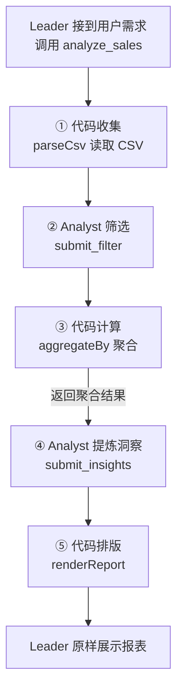

## 第 6c 章：实战 Level-2.5：数据分析与报表生成

上一章（6b）你做了单 Agent + 事件拦截的安全守卫。这一章换一个日常到不能再日常的需求：**让 Agent 收集数据、分析数据、产出报表**——月度销售汇总、运营周报、项目进度表，都是这个模式。

它同时是通往第 6d 章（多角色团队）的**过渡台阶**：6b 是"一个 Agent"，6d 是"三个角色协作"，中间缺的一步是——**两个 Agent 如何交接结构化产物**。本章就补这一步，而且这次交接要发生**两次**。

> **前置阅读**：[第 6a 章（单角色 Subagent）](06a-实战单角色Subagent.md)（`createAgentSession`）和[第 6b 章（安全编码守卫）](06b-实战安全编码守卫.md)（工具注册、`ExtensionAPI` 基本套路）。
>
> **代码量**：约 300 行（去注释）。数据源选**本地 CSV**（`data/sales.csv`，54 行月度销售流水），读取和聚合无需联网、结果可验证；Analyst 仍需配置模型认证并能连接模型服务——网络抓取对教程是灾难：结果不稳定、无法复现。

### 6c.1 设计：谁来收集，谁来算数，谁来排版

需求一句话：读一份销售流水，按用户的**自然语言**要求（"只看华东和华南，按产品汇总，指出增长最快的产品线"）产出一张「汇总表 + 关键洞察」的 Markdown 报表。

先问一个架构问题：这张报表**由谁生成**？

| 方案 | 做法 | 问题 |
|---|---|---|
| A：LLM 从头到尾做报表 | 模型自己读数、心算汇总、手写表格 | **算数不可靠**——12 个月 × 4 个地区的求和让模型口算必翻车；格式也漂移：竖线没转义、列对不齐、漏行多行 |
| B：全代码生成 | 写死筛选规则 | 规则是自然语言（"增长最快的产品线"），代码解析不了 |

正确答案是按流水线拆开——这正是本章的核心模式：

> **确定性工作交给代码，判断性工作交给模型。**
> - "哪些行进报表、写什么结论"是**判断** → 交给 Analyst（一个子 Agent Session）
> - "求和、分组、增长率怎么算，表格怎么转义竖线"是**计算** → 交给纯函数

注意这个分法比 6b 又前进了一步：这次两边的活儿都**真实且量大**——既有代码绝对干不了的部分（理解"增长最快的产品线"指什么），也有模型绝对干不好的部分（把 54 行流水加总成 6 个数）。**让代码算数、让模型选角度**，这才是日常数据报表的真实分工。

流水线一共五段，每段标注归属。② 和 ④ 是同一个 Analyst 子会话的两个阶段：



两个 Agent：Leader 和 Analyst。交接物发生两次，全部是**结构化 JSON**（`submit_filter` → `submit_insights`），而不是自由文本——这是第 6d 章 Reviewer 的 `submit_review`（结构化 verdict）的直系前身。而且第二次交接有个精妙之处：**Analyst 拿到的聚合数字是代码算好喂给它的**，提示词要求它引用这些数字。表格的聚合计算由代码保证；洞察的 `evidence` 仍是模型填写的字符串，Schema 只校验结构，不校验数字是否真实对应，仍需核验。

### 6c.2 示例数据与代码

示例数据是 `data/sales.csv`，54 行月度销售流水（2025-01 到 2025-06 × 4 个地区 × 2-3 条产品线），数据里埋了三条规律供分析用：扫地机器人逐月强劲增长、蓝牙耳机逐月下滑、华东体量最大。其中还有一条产品名带竖线（`智能音箱|青春版`），是给 6c.4 的刁钻用例准备的。

```csv
month,region,product,revenue,units
2025-01,华东,扫地机器人,273000,109
2025-01,华东,蓝牙耳机,361000,903
2025-01,华东,智能音箱|青春版,122000,407
...
```

创建 `.pi/extensions/data-collector/index.ts`（完整文件见 `examples/level-2b-data-collector/`）。下面两个代码块按顺序拼接，就是完整文件。第一段包含类型、确定性处理函数和会话初始化辅助函数；`parseCsv` 负责文件 I/O，过滤、聚合和渲染不调用模型：

```typescript
// 数据分析与报表生成扩展（Level 2.5）
//
// 场景：读取 data/sales.csv（月度销售流水），按用户的自然语言要求
// 生成一张「汇总表 + 关键洞察」的 Markdown 数据报表。
//
// 流水线（collect → filter → aggregate → narrate → render）：
//
//   你（用户）："按地区汇总销售额，只看华东和华南，给出增长最快的产品线"
//      ↓ analyze_sales 工具
//   【收集】   代码 parseCsv()                —— 读文件不需要智能
//   【筛选】   Analyst（LLM 子 Agent）把自然语言要求翻译成
//              submit_filter 的结构化条件     —— 哪些行进报表是判断
//   【计算】   代码 aggregateBy()  —— 求和、分组、增长率不交给模型
//   【洞察】   Analyst 阅读（代码算好的）聚合结果，
//              用 submit_insights 交付结论    —— 写什么洞察是判断
//   【渲染】   代码 renderReport()            —— 表格排版、竖线转义是计算
//
// 本章的核心模式一句话：**确定性工作交给代码，判断性工作交给模型**。
//   - "算术"是可精确验证的产物 → 代码算，数字永远可复现
//   - "理解自然语言要求、决定写什么结论" → 模型判断
//
// 交接物全部是结构化 JSON（submit_filter / submit_insights），
// 这是第 6d 章 submit_review（结构化 verdict）的直系前身。

import type { ExtensionAPI } from "@earendil-works/pi-coding-agent";
import { StringEnum } from "@earendil-works/pi-ai";
import {
  createAgentSession,
  DefaultResourceLoader,
  getAgentDir,
  ModelRuntime,
  SessionManager,
} from "@earendil-works/pi-coding-agent";
import { Type } from "typebox";
import { readFileSync } from "node:fs";
import { join } from "node:path";

// ---------------------------------------------------------------------------
// 1. 确定性部分：解析 CSV + 聚合计算 + 渲染 Markdown（纯代码，无 LLM）
// ---------------------------------------------------------------------------

interface SalesRow {
  month: string;
  region: string;
  product: string;
  revenue: number;
  units: number;
}

type Dimension = "region" | "product" | "month";
const DIMENSIONS = ["region", "product", "month"] as const;

/** 结构化筛选条件：模型把自然语言要求翻译成这三个字段 + 要出表的维度。 */
interface FilterSpec {
  regions?: string[];
  products?: string[];
  months?: string[];
  groupBy: Dimension[];
}

interface Insight {
  finding: string;
  evidence: string;
}

/** 解析 data/sales.csv。失败抛错，由工具层接住转成友好提示。 */
function parseCsv(cwd: string): SalesRow[] {
  // 本示例只处理无引号、字段内不含逗号的 CSV；兼容 BOM 与 CRLF。
  const raw = readFileSync(join(cwd, "data", "sales.csv"), "utf8").replace(/^\uFEFF/, "").trim();
  const [header, ...lines] = raw.split(/\r?\n/);
  if (header !== "month,region,product,revenue,units") {
    throw new Error(`CSV 表头不符合预期：${header}`);
  }
  if (lines.length === 0) throw new Error("CSV 没有数据行");
  return lines.map((line, index) => {
    const cells = line.split(",").map((cell) => cell.trim());
    const [month, region, product, revenue, units] = cells;
    if (cells.length !== 5 || cells.some((cell) => !cell) ||
        !/^\d{4}-(0[1-9]|1[0-2])$/.test(month) ||
        !Number.isFinite(Number(revenue)) || !Number.isFinite(Number(units))) {
      throw new Error(`CSV 第 ${index + 2} 行格式或数值无效`);
    }
    return { month, region, product, revenue: Number(revenue), units: Number(units) };
  });
}

/** 按结构化条件过滤行（字段缺省 = 不过滤该维度）。 */
function filterRows(rows: SalesRow[], filter: FilterSpec): SalesRow[] {
  const inSet = (v: string, set?: string[]) => !set || set.includes(v);
  return rows.filter(
    (r) => inSet(r.region, filter.regions) && inSet(r.product, filter.products) && inSet(r.month, filter.months)
  );
}

/** 按维度分组求和：营收、销量、首末月增长率。 */
function aggregateBy(rows: SalesRow[], dim: Dimension) {
  const groups = new Map<string, SalesRow[]>();
  for (const r of rows) {
    const key = r[dim];
    groups.set(key, [...(groups.get(key) ?? []), r]);
  }
  return [...groups.entries()]
    .map(([key, rs]) => {
      const revenue = rs.reduce((s, r) => s + r.revenue, 0);
      const units = rs.reduce((s, r) => s + r.units, 0);
      // 增长率是典型的"必须交给代码"的计算：按月排好后取首末两月
      const byMonth = new Map<string, number>();
      for (const r of rs) byMonth.set(r.month, (byMonth.get(r.month) ?? 0) + r.revenue);
      const monthsSorted = [...byMonth.keys()].sort();
      let growth: number | null = null;
      if (monthsSorted.length >= 2) {
        const first = byMonth.get(monthsSorted[0])!;
        const last = byMonth.get(monthsSorted[monthsSorted.length - 1])!;
        if (first > 0) growth = (last - first) / first;
      }
      return { key, revenue, units, growth };
    })
    .sort((a, b) => b.revenue - a.revenue); // 表格按营收降序，排版规则也是确定性的
}

/** 确定性渲染：竖线转义 + 数字格式化由代码保证，模型不参与格式。 */
const fmt = (n: number) => n.toLocaleString("zh-CN");

function formatMarkdownTable(headers: string[], body: string[][]): string {
  const escape = (s: string) => String(s).replace(/\|/g, "\\|");
  const lines = [
    `| ${headers.map(escape).join(" | ")} |`,
    `| ${headers.map(() => "---").join(" | ")} |`,
    ...body.map((cells) => `| ${cells.map(escape).join(" | ")} |`),
  ];
  return lines.join("\n");
}

const DIM_LABEL: Record<Dimension, string> = { region: "地区", product: "产品", month: "月份" };

/** 渲染最终报表：每维度一张汇总表 + 洞察列表。 */
function renderReport(aggregates: { dim: Dimension; rows: ReturnType<typeof aggregateBy> }[], insights: Insight[]): string {
  const parts: string[] = [];
  for (const { dim, rows } of aggregates) {
    parts.push(`### 按${DIM_LABEL[dim]}汇总\n`);
    parts.push(
      formatMarkdownTable(
        [DIM_LABEL[dim], "营收（元）", "销量（件）", "增长率"],
        rows.map((r) => [
          r.key,
          fmt(r.revenue),
          fmt(r.units),
          r.growth === null ? "—" : `${(r.growth * 100).toFixed(1)}%`,
        ])
      )
    );
    parts.push("");
  }
  if (insights.length > 0) {
    parts.push("### 关键洞察\n");
    for (const ins of insights) parts.push(`- **${ins.finding}**（${ins.evidence}）`);
    parts.push("");
  }
  return parts.join("\n");
}

// ---------------------------------------------------------------------------
// 2. 扩展入口：/sales 命令 + analyze_sales 工具
// ---------------------------------------------------------------------------

let sharedModelRuntimePromise: ReturnType<typeof ModelRuntime.create> | undefined;
function getSharedModelRuntime() {
  if (!sharedModelRuntimePromise) {
    sharedModelRuntimePromise = ModelRuntime.create();
  }
  return sharedModelRuntimePromise;
}

// 角色提示词的覆盖点在 ResourceLoader 上（新版 API）。
// 注意：自带的 loader 不会被 createAgentSession 自动 reload，必须手动调一次。
async function roleLoader(cwd: string, prompt: string) {
  const loader = new DefaultResourceLoader({
    cwd,
    agentDir: getAgentDir(),
    noExtensions: true, // 子会话只使用下方显式工具，避免自动执行项目/全局扩展
    systemPromptOverride: () => prompt, // 替换基础系统提示词为角色人设
    appendSystemPromptOverride: () => [], // 不让 APPEND_SYSTEM.md 污染角色人设
  });
  await loader.reload();
  return loader;
}
```

**要点 1**：`aggregateBy`/`filterRows`/`formatMarkdownTable` 都是纯函数，可以直接单测——喂 3 行假数据，断言输出。你**没法**给"让 GPT 心算增长率"写单测。

**要点 2**：`growth` 用首月→末月的营收增长率，是最简单的口径。真实业务里环比/同比口径更多，但注意那只是往 `aggregateBy` 里**加纯函数**，模型完全不用重新学（见 6c.6 练习）。

接着是扩展主体。`analyze_sales` 工具是唯一暴露给 Leader 的接口：

```typescript
export default function (pi: ExtensionAPI) {
  pi.on("session_start", async (_event, ctx) => {
    ctx.ui.notify("data-collector 扩展已加载：输入 /sales 生成销售数据报表", "info");
  });

  pi.registerCommand("sales", {
    description: "读取 data/sales.csv，按自然语言要求生成数据报表",
    handler: async (_args, ctx) => {
      ctx.ui.notify(
        "请在对话中描述分析要求（如“只看华东和华南，按产品汇总，指出增长最快的产品线”），模型会调用 analyze_sales 生成报表",
        "info"
      );
    },
  });

  // ---- 核心工具：analyze_sales ----
  // Leader 调用它 → 内部创建 Analyst 子 Agent → Analyst 先后用 submit_filter /
  // submit_insights 交付结构化结果 → 本工具用纯代码渲染报表 → 返回给 Leader。
  pi.registerTool({
    name: "analyze_sales",
    label: "Analyze sales data into a report",
    description:
      "读取项目的 data/sales.csv（月度销售流水），按 requirement 生成「汇总表 + 关键洞察」Markdown 报表。" +
      "requirement 里写清筛选范围和关注的维度，例如“只看华东和华南，按产品汇总，指出增长最快的产品线”。",
    parameters: Type.Object({
      requirement: Type.String({ description: "分析要求：筛选范围、要汇总的维度、想看什么结论" }),
    }),
    promptSnippet: "analyze_sales - 读取销售流水，按要求筛选、汇总并生成数据报表",
    promptGuidelines: [
      "analyze_sales 工具：把用户的分析要求原样写进 requirement，不要自己先筛一遍。",
      "analyze_sales 工具：返回的已经是渲染好的 Markdown 报表，直接展示给用户即可，不要再重新排版或复述数字。",
    ],
    async execute(_toolCallId, params, signal, onUpdate, ctx) {
      signal?.throwIfAborted();
      // 1.【收集】读文件失败不抛给用户，转成友好提示（详见 6c.5 常见坑）
      let allRows: SalesRow[];
      try {
        allRows = parseCsv(ctx.cwd);
      } catch (e) {
        return {
          content: [
            {
              type: "text",
              text: `读取 data/sales.csv 失败：${e instanceof Error ? e.message : String(e)}。请确认示例数据文件存在。`,
            },
          ],
          details: {},
        };
      }
      onUpdate?.({ content: [{ type: "text", text: `[analyst] 共 ${allRows.length} 行流水，开始分析...` }], details: {} });

      const validRegions = [...new Set(allRows.map((r) => r.region))];
      const validProducts = [...new Set(allRows.map((r) => r.product))];
      const validMonths = [...new Set(allRows.map((r) => r.month))].sort();

      // 两次结构化交接，都用闭包变量捕获：
      //   submit_filter  → 模型判断：哪些行进报表、按什么维度出表
      //   submit_insights → 模型判断：哪些结论值得写（evidence 必须引用代码算出的数字）
      let capturedFilter: FilterSpec | null = null;
      let capturedInsights: Insight[] | null = null;

      const { session } = await createAgentSession({
        cwd: ctx.cwd,
        sessionManager: SessionManager.inMemory(),
        modelRuntime: await getSharedModelRuntime(),
        tools: ["list_raw_rows", "submit_filter", "submit_insights"], // 白名单必须列出 customTools 的名字；通用工具一个不给
        customTools: [
          {
            name: "list_raw_rows",
            label: "List raw sales rows",
            description: "获取销售流水的全部原始数据（月份/地区/产品/营收/销量）。",
            parameters: Type.Object({}),
            async execute() {
              return { content: [{ type: "text", text: JSON.stringify(allRows) }], details: {} };
            },
          },
          {
            name: "submit_filter",
            executionMode: "sequential", // 结构化交接按调用顺序处理，避免同批校验失败被旧提交覆盖
            label: "Submit structured filter",
            description:
              "提交结构化筛选条件（本任务第一步）。regions/products/months 缺省表示不过滤该维度；" +
              "groupBy 是要出汇总表的维度，至少一个。提交后工具会返回由代码算好的聚合结果。",
            parameters: Type.Object({
              regions: Type.Optional(Type.Array(Type.String())),
              products: Type.Optional(Type.Array(Type.String())),
              months: Type.Optional(Type.Array(Type.String())),
              groupBy: Type.Array(StringEnum(DIMENSIONS), { minItems: 1, uniqueItems: true }),
            }),
            async execute(_id, p: FilterSpec) {
              // 新条件使旧表与洞察失效，避免重试失败后沿用旧结果。
              capturedFilter = null;
              capturedInsights = null;
              // 校验不过就不捕获、返回错误文本，让模型修正后重新提交
              const check = (label: string, given: string[] | undefined, valid: string[]) => {
                const bad = (given ?? []).filter((v) => !valid.includes(v));
                return bad.length > 0 ? `${label} 中存在未知值：${bad.join("、")}（有效值：${valid.join("、")}）` : null;
              };
              const err =
                check("regions", p.regions, validRegions) ??
                check("products", p.products, validProducts) ??
                check("months", p.months, validMonths);
              if (err) return { content: [{ type: "text", text: `筛选条件有误：${err}` }], details: {} };
              const filtered = filterRows(allRows, p);
              if (filtered.length === 0)
                return { content: [{ type: "text", text: "筛选结果为空，请放宽条件后重新提交。" }], details: {} };
              capturedFilter = p;
              // 【计算】聚合交给代码：模型拿到的每个数字都是算好的
              const aggregates = p.groupBy.map((dim) => ({ dim, rows: aggregateBy(filtered, dim) }));
              return {
                content: [
                  {
                    type: "text",
                    text:
                      `筛选后剩 ${filtered.length} 行。以下是代码计算出的聚合结果（营收单位：元；` +
                      `growth 为首月到末月的增长率），请基于这些数字提出洞察：\n` +
                      JSON.stringify(aggregates),
                  },
                ],
                details: { rows: filtered.length },
              };
            },
          },
          {
            name: "submit_insights",
            executionMode: "sequential", // 结构化交接按调用顺序处理，避免同批校验失败被旧提交覆盖
            label: "Submit key insights",
            description: "提交 1-3 条关键洞察（本任务第二步，也是最终交付）。evidence 必须引用聚合结果里的具体数字。",
            parameters: Type.Object({
              insights: Type.Array(
                Type.Object({
                  finding: Type.String({ minLength: 1, description: "一句话结论" }),
                  evidence: Type.String({ minLength: 1, description: "支撑该结论的具体数字，来自 submit_filter 返回的聚合结果" }),
                }),
                { minItems: 1, maxItems: 3 }
              ),
            }),
            async execute(_id, p: { insights: Insight[] }) {
              if (!capturedFilter) {
                return { content: [{ type: "text", text: "请先成功提交 submit_filter，再基于聚合结果提交洞察。" }], details: {} };
              }
              capturedInsights = p.insights;
              return { content: [{ type: "text", text: `已记录 ${p.insights.length} 条洞察。` }], details: {} };
            },
          },
        ],
        // 新版 API：角色提示词通过 resourceLoader 注入（见上方 roleLoader helper）
        resourceLoader: await roleLoader(ctx.cwd, [
          "你是数据分析员（Analyst）。",
          `用户要求：${params.requirement}`,
          "工作流程（三步，按顺序执行）：",
          "1. 先调用 list_raw_rows 查看全部原始流水；",
          "2. 把用户要求翻译成结构化条件，调用 submit_filter 提交（regions/products/months/groupBy）；",
          "   工具会返回由代码算好的聚合结果。",
          "3. 阅读聚合结果，调用 submit_insights 提交 1-3 条关键洞察，",
          "   evidence 必须引用聚合结果中的具体数字——不要自己心算，算术一律以工具返回为准。",
          "不要输出表格——渲染由外部代码完成，你只负责筛选条件和洞察。",
        ].join("\n")),
      });

      // 取消传播：上层中止时子 Agent 立刻停（第 6a 章学的模式）
      const onAbort = () => void session.abort();
      signal?.addEventListener("abort", onAbort, { once: true });
      const unsubscribe = session.subscribe((event) => {
        // prompt 的异步准备阶段也可能收到取消；等循环启动时再次中止。
        if (event.type === "agent_start" && signal?.aborted) onAbort();
        if (event.type === "tool_execution_end" && event.isError) {
          // Schema 校验失败会跳过 execute，也必须让旧产物失效。
          if (event.toolName === "submit_filter") {
            capturedFilter = null;
            capturedInsights = null;
          } else if (event.toolName === "submit_insights") {
            capturedInsights = null;
          }
        }
      });

      try {
        signal?.throwIfAborted();
        await session.prompt(`分析销售数据并提交：${params.requirement}`);
        signal?.throwIfAborted();
        const last = session.state.messages.at(-1);
        if (last?.role === "assistant" && (last.stopReason === "error" || last.stopReason === "aborted")) {
          throw new Error(last.errorMessage || `Analyst 未正常完成：${last.stopReason}`);
        }
      } finally {
        unsubscribe();
        signal?.removeEventListener("abort", onAbort);
        session.dispose();
      }

      if (!capturedFilter) {
        return {
          content: [{ type: "text", text: "ANALYST_DID_NOT_SUBMIT: Analyst 未调用 submit_filter，请重试。" }],
          details: { submitted: false },
        };
      }

      // 【渲染】确定性渲染：格式与数字都不经过模型
      // （capturedFilter 在闭包里赋值，类型系统看不见，需显式断言一次）
      const filter = capturedFilter as FilterSpec;
      const selectedRows = filterRows(allRows, filter);
      const aggregates = filter.groupBy.map((dim: Dimension) => ({
        dim,
        rows: aggregateBy(selectedRows, dim),
      }));
      const insights = capturedInsights ?? [];
      const report =
        renderReport(aggregates, insights) +
        (capturedInsights ? "" : "\n（Analyst 未提交洞察，以上仅有汇总表。）");
      return {
        content: [{ type: "text", text: report }],
        details: { rows: selectedRows.length, insights: insights.length },
      };
    },
  });
}
```

### 6c.3 逐段讲透四个设计决策

**① 关闭自动扩展加载，`tools` 白名单只列三个 customTools——Analyst 拿不到任何通用工具。** 注意一个容易踩的坑：**customTools 的名字必须出现在 `tools` 白名单里，模型才会真正拿到这个工具**，`tools: []` 不是"只要 customTools"而是"什么工具都没有"。正确写法是把 `list_raw_rows`、`submit_filter`、`submit_insights` 列进白名单，通用工具一个不给。这是 6b 学过的硬约束思想——Analyst 的能力被物理裁剪到只剩"看数据 + 交结构化结果"，它想乱跑都没有跑道。

**② 算术永远交给代码——这是和"LLM 全包"方案的本质区别。** `submit_filter` 被调用后，工具内部立刻用 `aggregateBy()` 算好聚合结果，**作为工具返回值喂回给同一个 Analyst**。也就是说模型提出洞察时，手里的每个数字都是代码算的，它只做两件事：把自然语言要求翻译成结构化筛选条件、从算好的数字里挑出值得说的结论。`submit_insights` 的 `evidence` 字段被明确要求“引用聚合结果中的具体数字”，但目前没有代码逐项验证。它可能抄错数字或做出错误推断；若要自动验真，应提交可核对的指标键、分组键和值，再由代码比对。

**③ `submit_filter` / `submit_insights` 是软约束的硬约束化。** 如果只在 system prompt 里写"请把结果以 JSON 返回"，模型可能夹带说明文字、可能截断、可能改字段名。而工具的 `parameters` 是 Schema 校验过的——`regions` 必须是字符串数组、`groupBy` 是枚举、`insights` 每项必须有 `finding`/`evidence`。这就是 6b 末尾"软约束 vs 硬约束"的又一次应用，也是第 6d 章 `submit_review` 的原型：一次任务里发生了**两次**结构化交接，第二次的输入（聚合结果）正是第一次的产物（筛选条件）算出来的——两段交接首尾咬合。两个提交工具还声明了 `executionMode: "sequential"`，使同批调用按顺序完成校验和执行，避免后一次校验失败先清空状态、较早的有效提交随后又把旧结果写回来。

**④ `ANALYST_DID_NOT_SUBMIT`——不假装有结论。** 如果模型没调用 `submit_filter` 就结束了（极端情况），工具返回明确的错误标记而不是把 Analyst 的自由文本当结果。宁可让 Leader 重试，也不要把不可靠的数据渲染进报表。如果筛选成功但未提交洞察，示例明确标注“仅有汇总表”；重新提交筛选条件会清空旧洞察，`submit_insights` 只能在筛选成功后调用，避免洞察与表格来自不同条件。

### 6c.4 运行与验证

```bash
cd examples/level-2b-data-collector
pi            # 启动后 /trust → /reload 加载扩展
```

然后直接对话：

```
你：帮我生成一张销售报表，只看华东和华南，按产品汇总，指出增长最快的产品线
模型：（调用 analyze_sales，requirement=你的原话）
      → Analyst: list_raw_rows → submit_filter(华东华南, groupBy=[product])
      → Analyst: submit_insights(扫地机器人增长最快…)
      → 返回渲染好的报表
```

验证"确定性"是否真的确定，分两层：

- **数字层**：固定同一份 CSV 和同一份 `FilterSpec`，**表里每个数字必须一字不差**。自然语言要求相同也可能被模型解释成不同筛选条件，先核对结构化条件再比较。
- **格式层**：表头、列序、降序排列、千分位格式一致（数字格式显式使用 `zh-CN`）；洞察的文字可能措辞不同。人工核对 `evidence` 中的每个数字和口径是否与聚合结果吻合；当前 Schema 不会替你完成这一步。

再试一个刁钻用例：`报表里加上智能音箱|青春版这条产品线`——产品名自带竖线，如果模型自己排版，竖线几乎必然炸表；用本方案，`escape` 会把它转义掉。

### 6c.5 常见坑

| 坑 | 现象 | 对策 |
|---|---|---|
| 工具返回数据过大 | 流水几千行时 `JSON.stringify(allRows)` 撑爆上下文，Analyst 开始漏行 | `list_raw_rows` 按需分页；或只传维度取值集合让模型先选条件再看行 |
| 筛选条件含未知值 | 模型把"华中"当地区提交，筛选悄悄变成空表 | 校验失败时**不捕获**、返回错误文本并列出有效值，让模型修正后重新提交（本示例的 `submit_filter` 就是这么做的） |
| 模型心算 | evidence 里出现表格没有的数字，且和代码算的对不上 | system prompt 明令"算术一律以工具返回为准"；验收时抽查 evidence 数字是否能在聚合结果里找到 |
| `JSON.parse`/读文件抛错没接住 | 没有 CSV 的目录里调用直接崩 | `try/catch` 包住 `parseCsv`，返回友好提示（本示例已做） |
| customTools 没列进 `tools` 白名单 | 子 Agent 对 customTools "视而不见"，永远不调用，一直返回 `XXX_DID_NOT_SUBMIT` | 传给 `createAgentSession` 时把 customTools 的名字也写进 `tools` 白名单 |
| 两 Agent 交接成本 | 每次调用都新建 Analyst 会话，token 重复花 | 简单场景够用；高频场景才考虑会话复用——先别优化 |

### 6c.6 进阶练习

1. **环比口径**：`aggregateBy` 目前只算首末月增长率，给它加一个"逐月环比"纯函数，报表多一列"月均环比"——注意改的只是**代码**，模型完全不用重新学。
2. **异常检测**：再写一个纯函数 `detectAnomalies(rows)`（比如单月营收偏离均值 2 个标准差就标红）， Analyst 的洞察多一个可引用的证据来源。
3. **CSV 输出**：给 `analyze_sales` 加 `format` 参数（`markdown`/`csv`）——同样是加一个纯函数 `renderCsv()`，对比方案 A：教模型写 CSV 每次都可能引号转义出错。

练习 3 值得停下想一下：如果当初选了方案 A（LLM 排版），加一种输出格式就要在 prompt 里教模型新语法，还可能出错；选了流水线方案，扩展格式只是加一个纯函数。**架构决策的复利，会在第二个需求出现时兑现。**

### 6c.7 本章与下一章的衔接

你现在已经掌握了：

- 创建子 Agent 会话并物理裁剪它的工具（6a）
- 用事件拦截做安全边界（6b）
- **两个 Agent 之间用结构化工具交付产物，而且一次任务里交接两次**（本章）

下一章把"2"扩到"3"：PM、Coder、Reviewer 三个角色，而且编排逻辑不再写死在代码里——交给 Leader 模型自己拿着 `delegate` 工具去编排。你在本章写的 `submit_filter`/`submit_insights`，到下一章会升级成带 `verdict` 的 `submit_review`；本章"Leader 只调一次工具"的直链，会变成"Leader 循环委派直到审查通过"的环。

---

← [上一章：第 6b 章 实战 Level-2：安全编码守卫扩展](06b-实战安全编码守卫.md) ｜ [下一章：第 6d 章 实战 Level-3：多角色 Agent 团队](06d-实战多角色Agent团队.md) →
